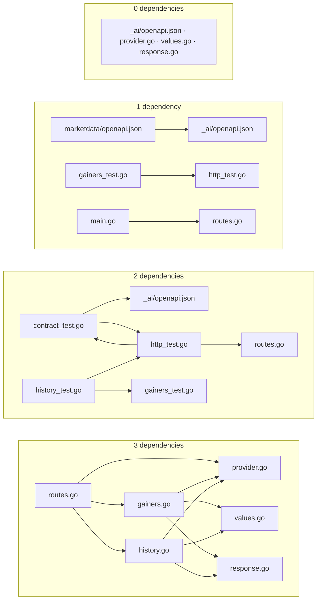

# Yahoo API file dependencies

Read the diagram from top to bottom. Each group contains files with the same number of **direct project dependencies**. An arrow points from a file to one it uses. A file name can appear again as the target of an arrow in another group.

All Go files except `main.go` live in `marketdata/`. The counts include Go symbol references, the schema checker's read of the OpenAPI contract, and the module OpenAPI file's references to that contract.

The test helpers depend on each other. `http_test.go` calls `assertContract` from `contract_test.go`, and `contract_test.go` uses the `gainPath` constant from `http_test.go`.
